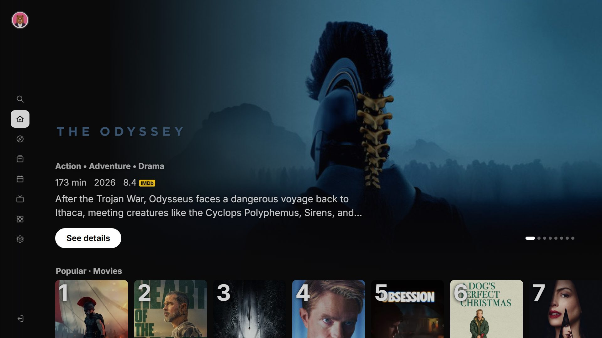

# StremCompat

  
  
  
  
  

<b>English</b> · <a href="README.pt.md">Português</a>

Your Stremio or Nuvio account and addons on TVs the official apps left behind: older LG webOS sets, Samsung Tizen and Android TV. Unofficial, free, and it needs no root.

## Pick your TV

| TV | Download and install |
|---|---|
| **LG** (webOS 3 and newer) | [StremCompat/webos](https://github.com/StremCompat/webos) |
| **Samsung** (Tizen 4 and newer) | [StremCompat/samsung](https://github.com/StremCompat/samsung) |
| **Android TV / Google TV** (7.0 and newer) | [StremCompat/android-tv](https://github.com/StremCompat/android-tv) |

## Two versions, side by side

Every TV has both, and they can be installed together:

| | **StremCompat** | **StremCompat Native** |
|---|---|---|
| What it is | The interface as a web page, the original version of the app | The same app rewritten in C, drawn by the TV's own graphics chip |
| Best for | Everyday use | Weaker TVs, or anyone who wants the smoothest scrolling |
| Status | **Stable, recommended** | **Beta**, not stable yet: faster, but expect rough edges |

Your account, library and settings carry over: on its first start the native version takes them from the web one, so there is no need to sign in again.

## A look inside

<table>
  <tr>
    <td></td>
    <td></td>
  </tr>
  <tr>
    <td></td>
    <td></td>
  </tr>
</table>

## Source code

| Repository | What is in it |
|---|---|
| [stremcompat](https://github.com/StremCompat/stremcompat) | The local server both versions use, and the web interface |
| [native](https://github.com/StremCompat/native) | The native interface in C (SDL2, OpenGL ES) |

StremCompat is not affiliated with Stremio, Nuvio, LG, Samsung or Google. It plays what your own addons provide.

If it has been useful to you, you can [buy me a coffee ☕](https://buymeacoffee.com/Alexesmm). Entirely optional.
