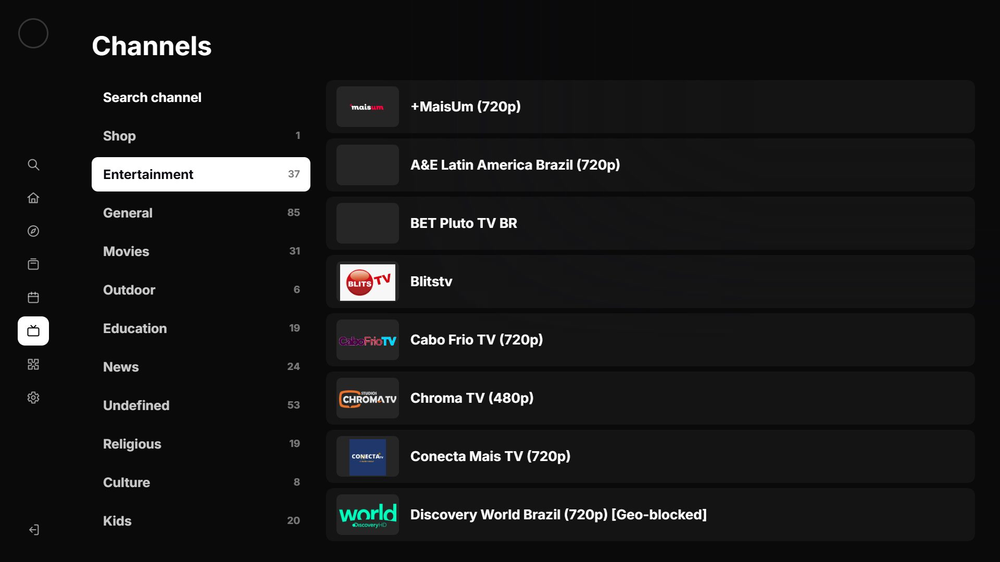

# StremCompat

  
  
  
  
  

<a href="README.md">English</a> · <b>Português</b>

Sua conta e seus addons do Stremio ou do Nuvio nas TVs que os apps oficiais deixaram de lado: LGs com webOS mais antigo, Samsung com Tizen e Android TV. Não oficial, gratuito e sem precisar de root.

## Escolha sua TV

| TV | Baixar e instalar |
|---|---|
| **LG** (webOS 3 ou mais novo) | [StremCompat/webos](https://github.com/StremCompat/webos/blob/main/README.pt.md) |
| **Samsung** (Tizen 4 ou mais novo) | [StremCompat/samsung](https://github.com/StremCompat/samsung/blob/main/README.pt.md) |
| **Android TV / Google TV** (7.0 ou mais novo) | [StremCompat/android-tv](https://github.com/StremCompat/android-tv/blob/main/README.pt.md) |

## Duas versões, lado a lado

Toda TV tem as duas, e elas podem ser instaladas juntas:

| | **StremCompat** | **StremCompat Native** |
|---|---|---|
| O que é | A interface como página web, a versão que o pessoal usa há anos | O mesmo app reescrito em C, desenhado pelo chip gráfico da própria TV |
| Melhor para | O uso do dia a dia | TVs mais fracas, ou quem quer a rolagem mais suave |
| Situação | **Estável, recomendada** | **Beta**, ainda não estável: mais rápida, mas pode ter falhas |

Sua conta, biblioteca e ajustes vêm junto: na primeira vez que abre, a versão Native pega tudo da versão web, então não precisa entrar de novo.

## Por dentro

<table>
  <tr>
    <td></td>
    <td></td>
  </tr>
  <tr>
    <td></td>
    <td></td>
  </tr>
</table>

## Código-fonte

| Repositório | O que tem nele |
|---|---|
| [stremcompat](https://github.com/StremCompat/stremcompat) | O servidor local que as duas versões usam, e a interface web |
| [native](https://github.com/StremCompat/native/blob/main/README.pt.md) | A interface nativa em C (SDL2, OpenGL ES) |

O StremCompat não tem ligação com Stremio, Nuvio, LG, Samsung ou Google. Ele toca o que os seus próprios addons oferecem.

Se ele foi útil para você, você pode me [pagar um café ☕](https://buymeacoffee.com/Alexesmm). Totalmente opcional. Uma estrela no GitHub também ajuda.
